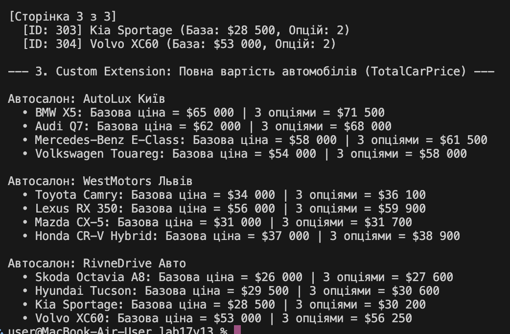

# Лабораторна робота №11

**Тема:** LINQ: SelectMany, пагінація й custom extensions.  
**Студентка:** Музичко Карина  
**Група / Варіант:** Варіант 13 (Автосалони та їхні автомобілі з опціями)  
**Навчальний заклад:** Рівненський фаховий коледж інформаційних технологій  
**Інструменти:** .NET SDK, Visual Studio Code, Git  

---

## Мета роботи
Навчитися використовувати оператор `SelectMany` для роботи з вкладеними колекціями, реалізовувати пагінацію даних за допомогою LINQ (`Skip`, `Take`), а також створювати власні методи розширення (Extension Methods) для `IEnumerable<T>` або ключових доменних сутностей.

---

## Хід роботи
1. Створено консольний проєкт `lab17v13` у директорії `OOP-Muzychko`.
2. Створено класи сутностей згідно з Варіантом 13:
   - `Dealership` (`Id`, `Name`, `List<Car> Cars`) — автосалон;
   - `Car` (`Id`, `Model`, `BasePrice`, `List<CarOption> Options`) — автомобіль;
   - `CarOption` (`Id`, `Name`, `Price`) — додаткова опція автомобіля.
3. Колекції сутностей заповнено тестовими даними (3 автосалони, 12 автомобілів та 21 додаткова опція).
4. Реалізовано LINQ-запити та бізнес-логіку згідно з індивідуальним завданням:
   - **`SelectMany`:** розгортання вкладених колекцій для отримання всіх опцій усіх автомобілів усіх автосалонів в одному плоскому списку.
   - **Пагінація (`Skip` та `Take`):** посторінковий вивід усіх автомобілів (по 5 автомобілів на сторінку).
   - **Custom Extension Method:** реалізовано власний метод розширення `TotalCarPrice()` для сутності `Car`, який обчислює загальну вартість автомобіля з урахуванням усіх встановлених опцій.
5. Результати роботи всіх запитів та пагінації виведено в консоль.

---

## Результат виконання програми (`dotnet run`)

)

---

## Висновки
- **Оператор `SelectMany`** дозволяє зручно "розгортати" ієрархічні структури (колекції в колекціях) в одну плоску послідовність, що спрощує подальшу фільтрацію, підрахунок та аналіз вкладених об'єктів.
- **Пагінація через `Skip()` та `Take()`** забезпечує ефективне розбиття великих наборів даних на керовані сторінки без необхідності завантажувати чи відображати весь масив даних одночасно.
- **Методи розширення (Extension Methods)** дозволяють інкапсулювати додаткову бізнес-логіку (як-от підрахунок повної вартості авто `TotalCarPrice()`) без зміни вихідного коду самої моделі сутності, зберігаючи чистий та читабельний синтаксис виклику.

---

## Відповіді на контрольні запитання

1. **Для чого використовується оператор `SelectMany`? Наведіть приклад, що демонструє його відмінність від `Select`.**  
   Оператор `SelectMany` застосовується для проєкції кожного елемента вхідної колекції в окрему послідовність із подальшим об'єднанням (flattening) усіх отриманих підколекцій в одну плоску послідовність.  
   - `dealerships.Select(d => d.Cars)` повертає колекцію списків (`IEnumerable<List<Car>>`).
   - `dealerships.SelectMany(d => d.Cars)` повертає єдиний плоский список усіх автомобілів (`IEnumerable<Car>`).

2. **Як реалізувати пагінацію даних за допомогою LINQ? Які методи для цього використовуються?**  
   Для пагінації використовуються методи `Skip(count)` (пропускає задану кількість елементів від початку) та `Take(count)` (вибирає вказану кількість наступних елементів). Для отримання сторінки з номером `pageNumber` (де нумерація починається з 1) та розміром `pageSize` використовується формула:  
   `collection.Skip((pageNumber - 1) * pageSize).Take(pageSize)`.

3. **Поясніть концепцію методів розширення. Як вони інтегруються з LINQ?**  
   Методи розширення (Extension Methods) дозволяють додавати нові методи до вже існуючих типів без зміни їхнього вихідного коду, наслідування чи перекомпіляції. Вони створюються як `static` методи всередині `static` класу, де перед першим параметром ставиться ключове слово `this`. Весь LINQ to Objects реалізований саме як набір методів розширення для інтерфейсу `IEnumerable<T>` у просторі імен `System.Linq`.

4. **Наведіть приклад власного методу розширення для `IEnumerable<T>` та поясніть його призначення.**  
   ```csharp
   public static class EnumerableExtensions
   {
       public static IEnumerable<T> Paginate<T>(this IEnumerable<T> source, int page, int pageSize)
       {
           return source.Skip((page - 1) * pageSize).Take(pageSize);
       }
   }