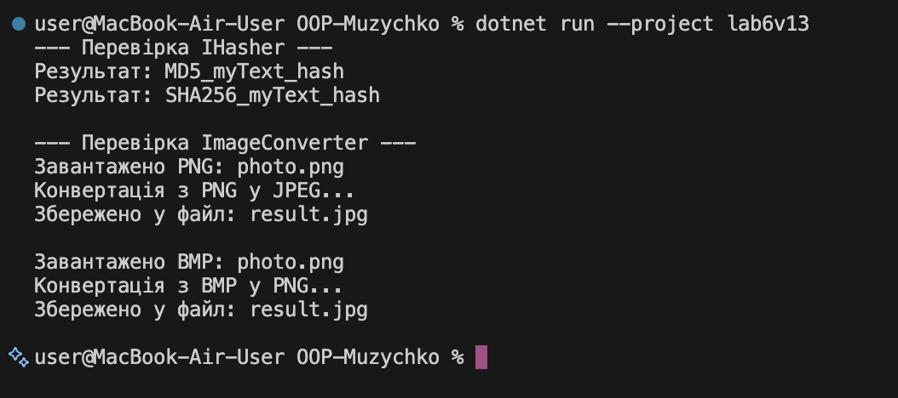

# Лабораторна робота №6

**Тема:** Абстрактні класи та інтерфейси. Контракти та реалізації.  
**Студентка:** Музичко Карина  
**Група / Варіант:** Варіант 13 (`IHasher` та `ImageConverter`)  
**Навчальний заклад:** Рівненський фаховий коледж інформаційних технологій  
**Інструменти:** .NET SDK, Visual Studio Code, Git  

---

## Мета роботи
Навчитися створювати та використовувати абстрактні класи та інтерфейси для визначення контрактів і реалізації спільної логіки, а також розуміти критерії вибору між ними.

---

## Хід роботи
1. Створено консольний проєкт `lab6v13`.
2. Реалізовано інтерфейс `IHasher` із методом `ComputeHash()` та два класи-реалізації `MD5Hasher` і `SHA256Hasher`.
3. Створено абстрактний клас `ImageConverter` із абстрактними методами `LoadImage()`, `ConvertImage()` та конкретним методом `SaveImage()`.
4. Створено похідні класи `PngToJpegConverter` та `BmpToPngConverter`, що реалізують абстрактні методи базового класу.
5. У методі `Main` через колекції `List<IHasher>` та `List<ImageConverter>` продемонстровано поліморфний виклик методів інтерфейсу та абстрактного класу.

---

## Результат виконання програми

**

---

## Відповіді на контрольні запитання

1. **У чому полягає основна відмінність між абстрактним класом та інтерфейсом?**  
   Абстрактний клас описує сутність об'єкта (зв'язок «IS-A»), може містити реалізований код та зберігати стан (поля). Інтерфейс виступає чистим контрактом поведінки (зв'язок «CAN-DO») без збереження стану.

2. **Коли доцільно використовувати абстрактний клас, а коли — інтерфейс?**  
   Абстрактний клас обирають для споріднених класів, яким потрібен спільний код чи стан. Інтерфейс обирають для визначення однакових дій для абсолютно різних, не пов'язаних між собою класів.

3. **Чи може клас успадковувати від кількох абстрактних класів? А реалізовувати кілька інтерфейсів?**  
   У C# клас може успадкувати лише один абстрактний клас (одиночне успадкування), але може реалізовувати довільну кількість інтерфейсів одночасно.

4. **Як абстрактні класи та інтерфейси сприяють поліморфізму та гнучкості архітектури?**  
   Вони дозволяють працювати з різними об'єктами через їхній спільний базовий тип або контракт. Це дає змогу легко підміняти реалізації та додавати нові класи без зміни існуючого коду.