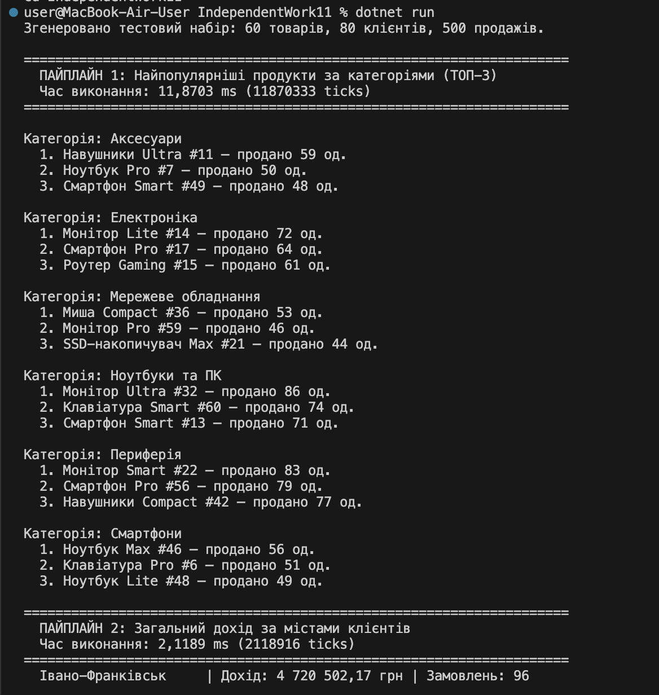
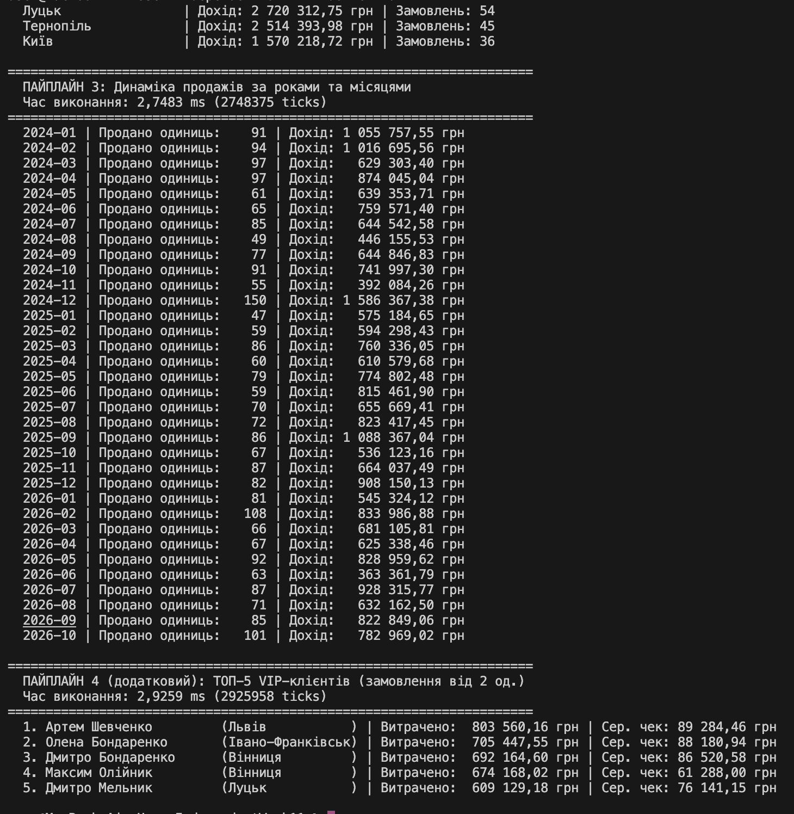

# Самостійна робота №17: LINQ pipelines: ETL та аналітика

## Опис проєкту
Консольний застосунок **`IndependentWork11`** моделює процеси **ETL (Extract, Transform, Load)** та бізнес-аналітики для предметної області «Продажі» за допомогою декларативних LINQ-пайплайнів у C#.

### Реалізовані аналітичні пайплайни:
1. **Найпопулярніші продукти за категоріями** — групування продажів за товарами, об'єднання з довідником продуктів та вибірка ТОП-3 товарів у кожній категорії.
2. **Загальний дохід за містами клієнтів** — об'єднання продажів із продуктами та клієнтами, підрахунок виручки по кожному місту та сортування за спаданням.
3. **Продажі за місяцями та роками** — часова агрегація обсягів продажів і доходу в хронологічному порядку.
4. **ТОП-5 VIP-клієнтів (додатковий пайплайн)** — фільтрація оптових замовлень (`Where`), розрахунок сумарних витрат і середнього чека (`Sum`, `Average`) з приєднанням профілів клієнтів.

