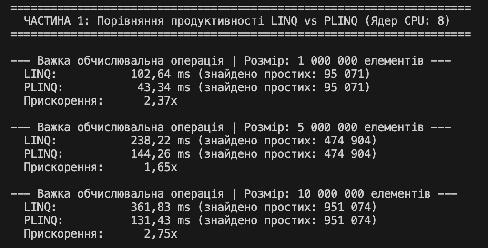
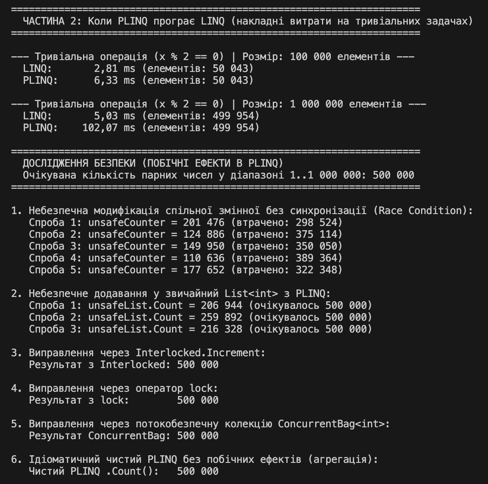

# Самостійна робота №18: PLINQ: дослідження продуктивності та безпеки

## Опис проєкту
Консольний застосунок **`IndependentWork12`** досліджує роботу **Parallel LINQ (PLINQ)** у порівнянні зі звичайним послідовним **LINQ**:
- Вимірювання продуктивності на великих колекціях (1M, 5M та 10M елементів) для обчислювально інтенсивних операцій (перевірка на просте число + тригонометричні/логарифмічні обчислення).
- Демонстрація накладних витрат (overhead) PLINQ на тривіальних операціях.
- Демонстрація проблем потокобезпечності (Race Condition, пошкодження `List<T>`) при побічних ефектах у PLINQ та способів їх вирішення (`Interlocked`, `lock`, `ConcurrentBag<T>`, чистий функціональний підхід).

