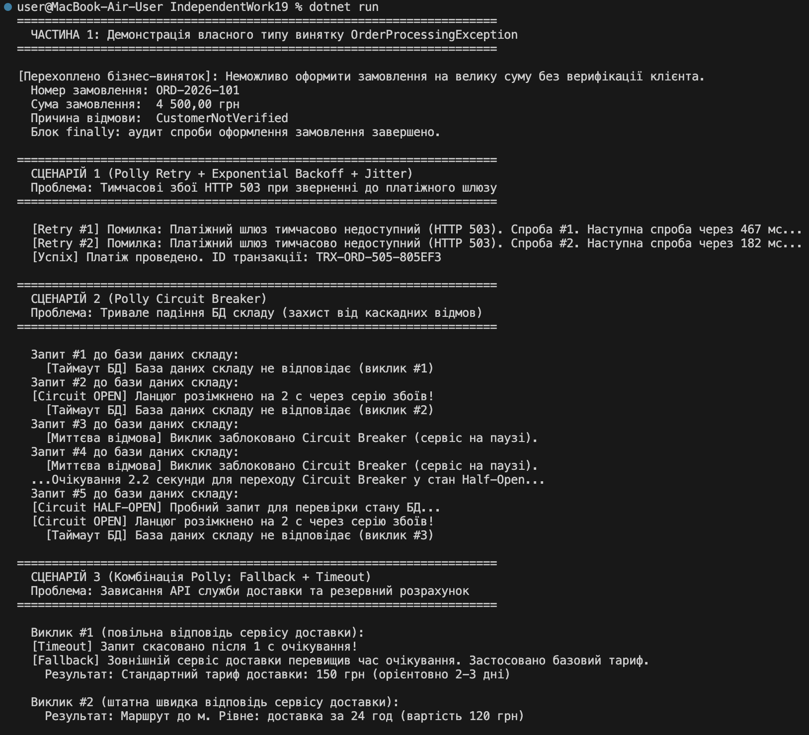

# Самостійна робота №19: Дизайн винятків і політики retry: теорія та кейси Polly

## Опис проєкту
Консольний застосунок **`IndependentWork19`** демонструє проєктування власних типів винятків у .NET та реалізацію патернів відмовостійкості (Resilience Patterns) за допомогою актуального API бібліотеки **Polly (`ResiliencePipelineBuilder`)**:
- **Власний виняток `OrderProcessingException`** з трьома стандартними конструкторами та бізнес-властивостями (`OrderId`, `OrderAmount`, `FailureReason`).
- **Сценарій 1 (Retry + Exponential Backoff + Jitter)** — повторні спроби оплати при тимчасових збоях платіжного шлюзу (HTTP 503).
- **Сценарій 2 (Circuit Breaker)** — захист від каскадних відмов при тривалій недоступності бази даних складу.
- **Сценарій 3 (Fallback + Timeout)** — скасування завислого запиту до API служби доставки та повернення резервного тарифу.
