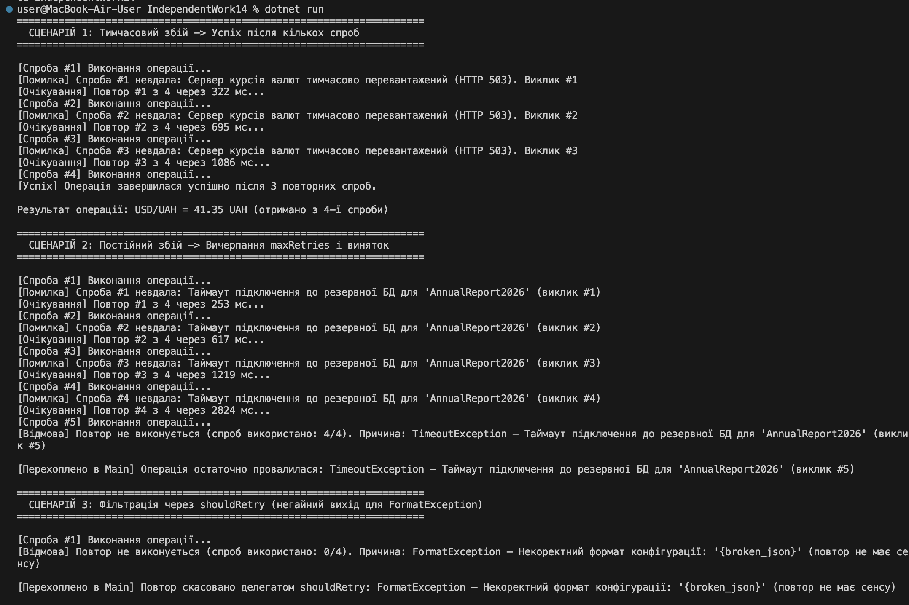

# Самостійна робота №20: Реалізація exponential backoff

## Опис проєкту
Консольний застосунок **`IndependentWork14`** містить власну узагальнену реалізацію класу **`RetryPolicy`**, який забезпечує повторне виконання операцій `Func<T>` за алгоритмом **Exponential Backoff з випадковим Jitter** та фільтрацією помилок через делегат `shouldRetry`.

### Продемонстровані сценарії у `Program.cs`:
1. **Успіх після тимчасових збоїв** — отримання курсу валют із зовнішнього сервісу, який перші 3 виклики повертає `HttpRequestException`, а на 4-й успішно повертає результат.
2. **Вичерпання усіх спроб (`maxRetries`)** — звернення до недоступної бази даних, що завершується повторним викиданням `TimeoutException` після 4 невдалих повторів.
3. **Фільтрація через `shouldRetry`** — миттєве
